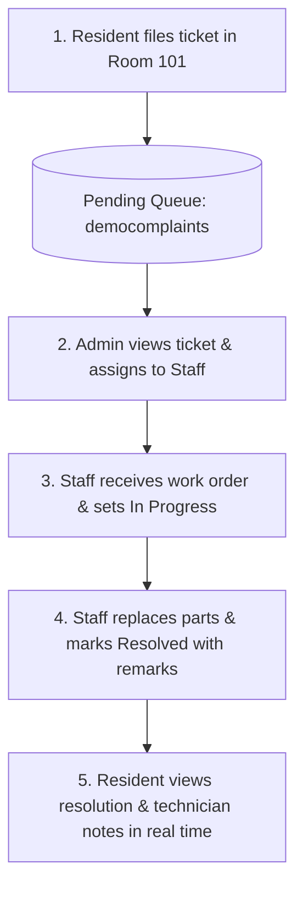

<div align="center">


# FixMate

**Maintenance Made Simple.**

A modern full-stack MERN platform designed to streamline complaint management, technician work orders, and resolution tracking for PG and hostel accommodations. Features a dedicated, isolated **Three-Role Interactive Demo Sandbox** alongside the real authentication system.

[](https://react.dev/)
[](https://nodejs.org/)
[](https://expressjs.com/)
[](https://www.mongodb.com/)
[](https://tailwindcss.com/)
[](https://vitejs.dev/)
[](https://opensource.org/licenses/MIT)

</div>

---

## 🌐 Dual-System Architecture Overview

FixMate implements a clean architectural separation between the **Real Production Application** and the **Interactive Demo Sandbox**:

```
                          ┌───────────────────────────┐
                          │     FixMate Landing       │
                          │        Page (/)           │
                          └──────┬─────────────┬──────┘
                                 │             │
                "Sign In" clicked│             │"Explore Interactive Dashboard"
                                 ▼             ▼
      ┌──────────────────────────────┐     ┌──────────────────────────────┐
      │     Real Auth Flow           │     │    Interactive Demo Flow     │
      │       (/login)               │     │           (/demo)            │
      ├──────────────────────────────┤     ├──────────────────────────────┤
      │ • Registered user accounts   │     │ • 3 Role Exploration Cards:  │
      │ • Backend: /api/auth/login   │     │   - Explore as Admin         │
      │ • Signed with JWT_SECRET     │     │   - Explore as Staff         │
      │ • Storage: fixmate_real_user │     │   - Explore as Resident      │
      │ • Protected: RealProtected   │     │ • Backend: /api/demo/auth/me │
      │ • Routes: /dashboard/*       │     │ • Signed: DEMO_JWT_SECRET    │
      │                              │     │ • Storage: fixmate_demo_...  │
      │                              │     │ • Protected: DemoProtected   │
      │                              │     │ • Routes: /demo/*            │
      └──────────────┬───────────────┘     └──────────────┬───────────────┘
                     │                                    │
                     ▼                                    ▼
      ┌──────────────────────────────┐     ┌──────────────────────────────┐
      │   Production Database Layer  │     │    Isolated Demo Database    │
      │   (MongoDB Atlas)            │     │    Layer (MongoDB Atlas)     │
      ├──────────────────────────────┤     ├──────────────────────────────┤
      │ • Collection: `users`        │     │ • Collection: `demousers`    │
      │ • Collection: `rooms`        │     │ • Collection: `demorooms`    │
      │ • Collection: `complaints`   │     │ • Collection: `democomplaints│
      └──────────────────────────────┘     └──────────────────────────────┘
```

| Capability | Flow A: Real Application | Flow B: Interactive Demo Sandbox |
| :--- | :--- | :--- |
| **Entry Point** | `/login` or `/register` | `/demo` (Role Selector) |
| **Active Routes** | `/dashboard/admin`, `/dashboard/staff`, `/dashboard/resident` | `/demo/admin`, `/demo/staff`, `/demo/resident` |
| **Cryptographic Secret** | `JWT_SECRET` | `DEMO_JWT_SECRET` |
| **Token Claims** | `{ id, role }` | `{ id, name, email, role, isDemo: true }` |
| **Session Lifetime** | Standard authenticated user session | 2-hour temporary signed demo session |
| **Client Storage Key** | `localStorage['fixmate_real_user']` | `localStorage['fixmate_demo_session']` |
| **API Client** | `services/api.js` (`/api/*`) | `services/demoApi.js` (`/api/demo/*`) |
| **Database Layer** | Collections: `users`, `rooms`, `complaints` | Collections: `demousers`, `demorooms`, `democomplaints` |
| **Token Cross-Rejection** | Demo tokens rejected with HTTP 401 | Real tokens rejected with HTTP 401 |
| **Safe Reset Action** | *Disabled (Protects production data)* | `POST /api/demo/reset` (1-click sample reset) |

---

## 📖 About

FixMate replaces manual paper registers and unorganized messaging with a centralized, role-based maintenance tracking system. It connects hostel residents, maintenance technicians, and hostel administrators in a unified, transparent workflow—ensuring issues are reported quickly, assigned without delay, and resolved with full accountability.

---

## ✨ Key Features

### 🏠 Resident Portal (`/dashboard/resident` & `/demo/resident`)
- **Submit Complaints:** File maintenance tickets across categories (*Electrical, Plumbing, Cleaning, Wi-Fi, Other*) with custom descriptions and priority levels (*Low, Medium, High, Urgent*).
- **Live Status Stepper:** Real-time visual progress tracker (`Pending Review` ➔ `Assigned to Staff` ➔ `In Progress` ➔ `Resolved`).
- **History & Details:** Access complaint logs, photo attachments, assigned technician contact cards, and completion remarks.

### 👑 Administrator Operations (`/dashboard/admin` & `/demo/admin`)
- **Operations Dashboard:** Live metrics for total complaints, pending review queue, active in-progress repairs, and room bed occupancy.
- **Ticket Allocation:** Assign pending tickets to field technicians via instant dropdown allocation.
- **Room Management:** Create and manage hostel rooms, wings/blocks, floor numbers, and bed capacities.
- **Staff Roster:** Provision and onboard authenticated maintenance staff accounts.

### 🔧 Maintenance Staff Hub (`/dashboard/staff` & `/demo/staff`)
- **Work Order Queue:** Dedicated feed of maintenance jobs assigned specifically to the technician.
- **Status Progression:** Seamlessly transition assigned work orders from `Assigned` to `In Progress` and mark as `Resolved`.
- **Technician Notes:** Record repair findings, replacement parts, and handover remarks upon job resolution.

### ⚡ Interactive Recruiter Sandbox (`/demo`)
- **Instant Role Switcher:** Explore Admin, Staff, or Resident dashboards without registration or email verification.
- **Shared Sandbox Dataset:** All three demo roles interact with the same isolated demo data layer, allowing end-to-end verification of ticket lifecycles.
- **Safe Reset Mechanism:** Reset demo data back to clean default fixtures at any time using the sticky banner.

---

## 🛠️ Tech Stack

| Category | Technologies |
| :--- | :--- |
| **Frontend** | React 18, Vite 6, React Router DOM v6, Axios, Lucide React, Tailwind CSS 3.4 |
| **Backend** | Node.js (v20+), Express.js (REST API Architecture, Sliding-Window Rate Limiting) |
| **Database** | MongoDB Atlas, Mongoose 8 (Dedicated real & demo schemas, validation & population) |
| **Authentication** | Dual JWT signing (`JWT_SECRET` & `DEMO_JWT_SECRET`), `bcryptjs` password hashing |
| **Deployment** | Vercel (Frontend with SPA rewrites), Render (Backend with CORS validation) |

---

## 🔄 End-to-End Complaint Lifecycle



---

## 📸 Screenshots

### 1. Public & Authentication

| Home Landing Page | Dedicated Sign In |
| :---: | :---: |
|  |  |
| *Modern showcase, feature highlights & entry points* | *Secure login strictly for registered database accounts* |

### 2. Role-Based Dashboards

| Resident Portal | Maintenance Staff Hub |
| :---: | :---: |
|  |  |
| *Ticket submission, room details & resolution tracker* | *Assigned work orders, status controls & repair logs* |

| Admin Master Operations |
| :---: |
|  |
| *Hostel operations overview, technician dispatch & room capacity* |

---

## 📂 Project Structure

```text
FixMate/
├── Backend/
│   ├── src/
│   │   ├── config/
│   │   │   └── db.js                 # MongoDB connection & error diagnostics
│   │   ├── controllers/
│   │   │   ├── authController.js     # Real user login, registration, staff creation
│   │   │   ├── complaintController.js# Real complaint CRUD & allocation
│   │   │   ├── demoController.js     # Demo authentication, seeding, CRUD & reset
│   │   │   ├── roomController.js     # Room & occupancy management
│   │   │   └── userController.js     # User administration
│   │   ├── middleware/
│   │   │   ├── auth.js               # Real JWT authentication guard (JWT_SECRET)
│   │   │   ├── demoAuth.js           # Demo JWT authentication guard (DEMO_JWT_SECRET)
│   │   │   ├── rateLimiter.js        # Sliding-window rate limiter
│   │   │   └── role.js               # Role-based authorization middleware
│   │   ├── models/
│   │   │   ├── Complaint.js          # Real complaint schema
│   │   │   ├── DemoComplaint.js      # Isolated demo complaint schema
│   │   │   ├── DemoRoom.js           # Isolated demo room schema
│   │   │   ├── DemoUser.js           # Isolated demo user schema
│   │   │   ├── Room.js               # Real room schema
│   │   │   └── User.js               # Real user schema
│   │   ├── routes/
│   │   │   ├── authRoutes.js         # /api/auth
│   │   │   ├── complaintRoutes.js    # /api/complaints
│   │   │   ├── demoRoutes.js         # /api/demo
│   │   │   ├── roomRoutes.js         # /api/rooms
│   │   │   └── userRoutes.js         # /api/users
│   │   ├── app.js                    # Express app configuration & CORS setup
│   │   ├── seed.js                   # Real database seed script
│   │   ├── server.js                 # HTTP server entry point
│   │   └── viewDb.js                 # CLI database inspector utility
│   ├── .env.example
│   └── package.json
│
├── Frontend/
│   ├── public/                       # PWA manifest, favicons & _redirects
│   ├── src/
│   │   ├── assets/                   # Application icons & branding
│   │   ├── components/
│   │   │   ├── ComplaintCard.jsx     # Reusable ticket card with status tags
│   │   │   ├── DashboardFooter.jsx   # Compact internal dashboard footer
│   │   │   ├── DemoBanner.jsx        # Sticky top demo banner with reset & exit
│   │   │   ├── Navbar.jsx            # Dynamic navigation bar with search
│   │   │   ├── PublicFooter.jsx      # Comprehensive public website footer
│   │   │   └── Sidebar.jsx           # Role-based navigation sidebar
│   │   ├── context/
│   │   │   ├── AuthContext.jsx       # Real authentication context
│   │   │   ├── DemoAuthContext.jsx   # Demo authentication context
│   │   │   └── SessionContext.jsx    # Unified ambient bridge for shared pages
│   │   ├── pages/
│   │   │   ├── admin/                # Admin Dashboard, Complaints, Rooms, Staff
│   │   │   ├── resident/             # Resident Dashboard, New Ticket, Ticket Details
│   │   │   ├── staff/                # Staff Work Orders Dashboard
│   │   │   ├── About.jsx             # Public About page
│   │   │   ├── Contact.jsx           # Public Contact page
│   │   │   ├── Demo.jsx              # Dedicated 3-Role Interactive Demo Hub
│   │   │   ├── Features.jsx          # Public Features showcase
│   │   │   ├── Home.jsx              # Public Landing page
│   │   │   ├── Login.jsx             # Real user sign-in page
│   │   │   ├── Privacy.jsx           # Privacy policy
│   │   │   ├── Register.jsx          # Resident registration page
│   │   │   └── Terms.jsx             # Terms of service
│   │   ├── services/
│   │   │   ├── api.js                # Axios client for Real API (/api/*)
│   │   │   └── demoApi.js            # Axios client for Demo API (/api/demo/*)
│   │   ├── App.jsx                   # Central routing & dual route guards
│   │   ├── index.css                 # Tailwind directives & keyframe animations
│   │   └── main.jsx                  # React application DOM entry point
│   ├── .env.example
│   ├── tailwind.config.js
│   ├── vercel.json                   # Vercel deployment rewrite rules
│   ├── vite.config.js
│   └── package.json
│
├── screenshots/                      # Documentation UI screenshots
└── README.md
```

---

## 🚀 Installation & Local Setup

### 1. Prerequisites
- **Node.js**: v20 or higher installed ([Download Node.js](https://nodejs.org/))
- **MongoDB**: Local MongoDB instance (`mongodb://127.0.0.1:27017`) or free [MongoDB Atlas](https://www.mongodb.com/atlas) cluster connection string.
- **Git**: Installed and configured.

### 2. Clone the Repository
```bash
git clone https://github.com/r0kumar/FixMate-PG-Hostel-Maintenance-Tracker.git
cd FixMate-PG-Hostel-Maintenance-Tracker
```

---

### 3. Backend Setup

Navigate to the `Backend` directory and install dependencies:
```bash
cd Backend
npm install
```

Create your `.env` configuration file from the provided example:
```bash
cp .env.example .env
```

Configure the environment variables in `Backend/.env`:
```env
# Server Port
PORT=5000

# MongoDB Connection String (Atlas URI in production, or local URI in dev)
MONGO_URI=mongodb://127.0.0.1:27017/fixmate

# JWT Secret for Real Authentication
JWT_SECRET=your_jwt_secret_key_here

# Frontend URL for CORS (Set to your Vercel URL in production)
CLIENT_URL=http://localhost:5173

# Interactive Demo Sandbox Controls
DEMO_MODE_ENABLED=true
DEMO_JWT_SECRET=your_demo_jwt_secret_here
```

#### Available Backend Scripts:
```bash
npm run dev      # Starts the backend development server with hot-reload on http://localhost:5000
npm start        # Starts the production Node server
npm run seed     # Pre-loads sample real accounts (Admin, Staff, Resident) and sample rooms
npm run db:view  # Terminal database inspector displaying live collections in formatted tables
```

---

### 4. Frontend Setup

In a new terminal window, navigate to the `Frontend` directory and install dependencies:
```bash
cd Frontend
npm install
```

Create your `.env` configuration file from the provided example:
```bash
cp .env.example .env
```

Configure `Frontend/.env`:
```env
# Backend API Base URL (Include '/api' suffix)
VITE_API_URL=http://localhost:5000/api
```

#### Available Frontend Scripts:
```bash
npm run dev      # Starts Vite local dev server on http://localhost:5173
npm run build    # Compiles and optimizes production bundle into Frontend/dist/
npm run preview  # Locally tests the built production bundle
```

---

## 🔑 Pre-Seeded Real Accounts (via `npm run seed`)

These accounts are strictly for logging into the **Real Application** (`/login`):

| Role | Email | Password | Access Scope |
| :--- | :--- | :--- | :--- |
| **Admin** | `admin@fixmate.com` | `password123` | Master operations, complaint allocation & room setup |
| **Staff** | `staff@fixmate.com` | `password123` | Assigned technician tasks & repair progress |
| **Resident** | `resident@fixmate.com` | `password123` | Room 101 maintenance complaint submission & tracking |

> 💡 **Exploring via Demo Mode:**  
> To test the application without entering credentials, click **Explore Interactive Dashboard** on the home page or navigate directly to `/demo`. Select any of the three role cards to launch a signed, backend-authorized demo session in an isolated sandbox dataset.

---

## 🔒 Security Best Practices Implemented

1. **Dual Secret Cryptography:** `DEMO_JWT_SECRET` is completely separate from `JWT_SECRET`. Real tokens are rejected with HTTP 401 on demo routes, and demo tokens are rejected on real routes.
2. **Server-Side Master Switch:** Setting `DEMO_MODE_ENABLED=false` in the backend environment immediately disables all `/api/demo/*` endpoints with HTTP 403.
3. **Sliding-Window Rate Limiting:** Custom zero-dependency in-memory rate limiters protect demo authentication (20 req/15min), sample data reset (6 req/15min), and general demo queries (200 req/15min).
4. **Data Layer Isolation:** Demo endpoints strictly interact with dedicated `DemoUser`, `DemoRoom`, and `DemoComplaint` collections in Atlas. Real production database records cannot be viewed, altered, or deleted through demo mode.
5. **CORS Restrictions:** Dynamic origin validation restricts cross-origin communication strictly to configured local and production domains.

---

## 🔮 Future Improvements

1. **Live WebSockets:** Real-time push updates via Socket.io for immediate technician assignment alerts.
2. **Cloud Media Storage:** Direct photo uploads to Cloudinary or AWS S3 for maintenance before/after verification photos.
3. **Automated SLA Escalation:** Automatic alerts for tickets pending for more than 24/48 hours.
4. **SMS / WhatsApp Alerts:** Instant messaging notifications for urgent room repair status updates.

---

<div align="center">
  <sub>Built with ❤️ by <a href="https://github.com/r0kumar">r0kumar</a> • Licensed under the MIT License</sub>
</div>
