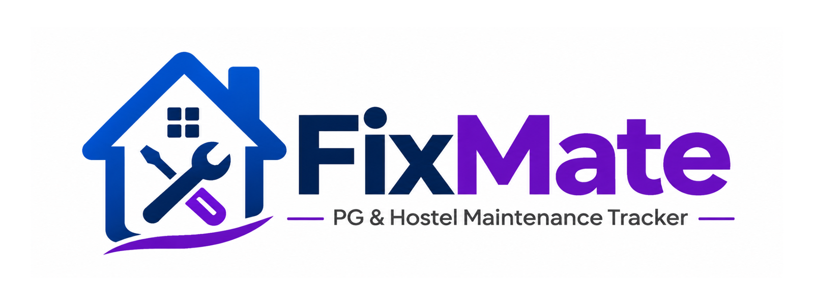
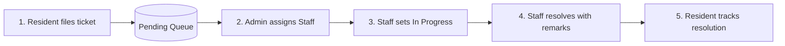
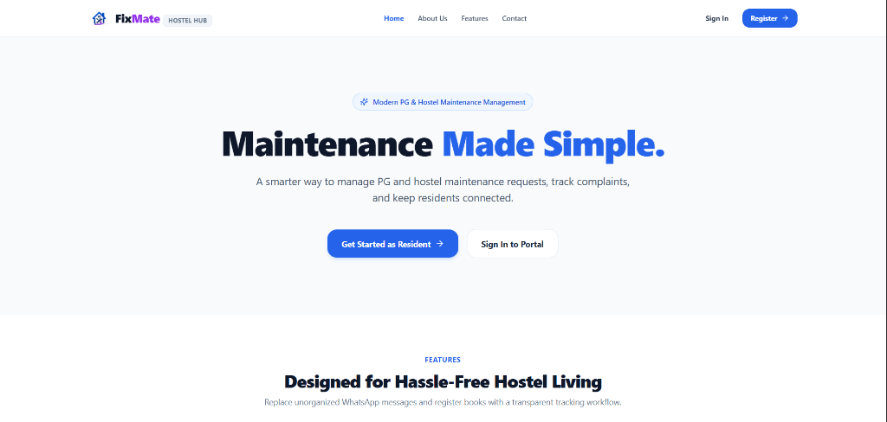
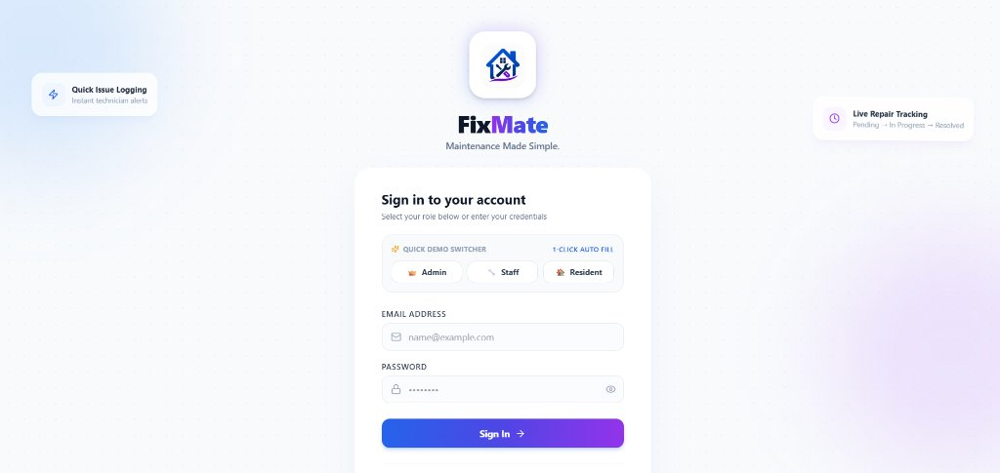
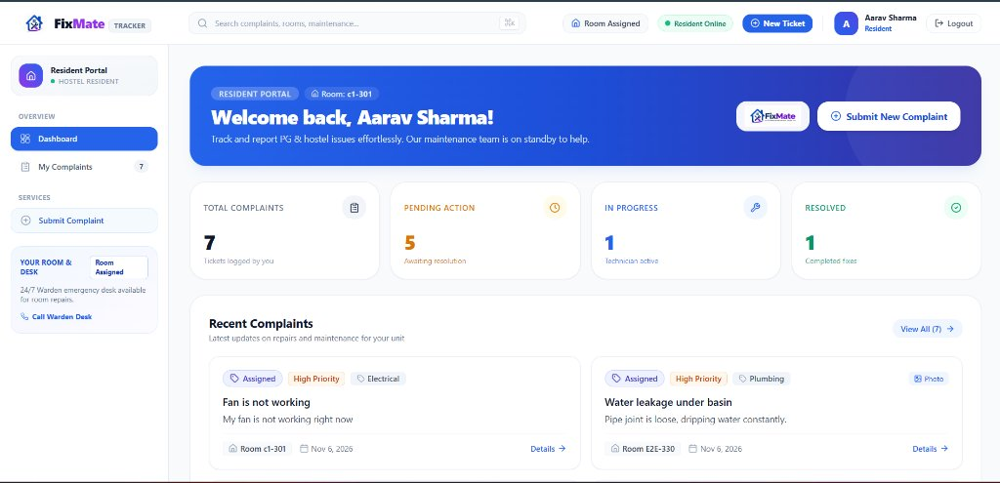
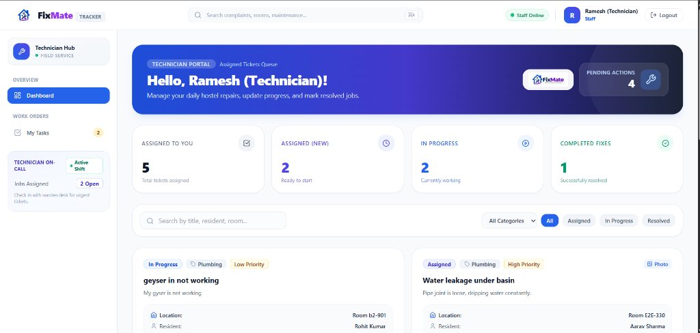
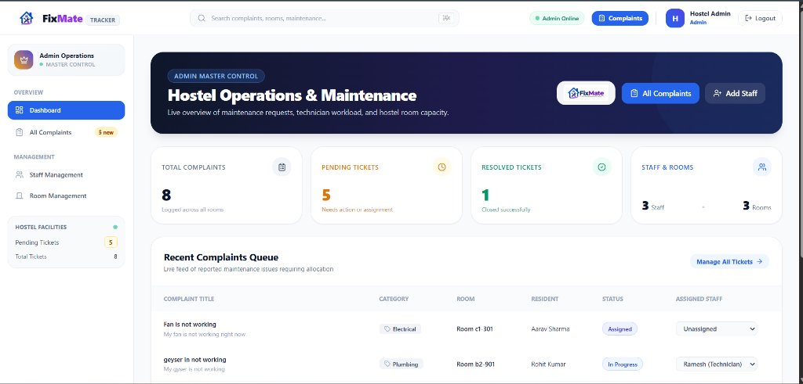

<div align="center">



# FixMate

**Maintenance Made Simple.**

A modern full-stack MERN platform to streamline complaint management, technician work orders, and resolution tracking for PG and hostel accommodations. Includes an isolated **Three-Role Interactive Demo Sandbox** alongside the real authentication system.

[](https://fix-mate-pg-hostel-maintenance-trac.vercel.app/)

[](https://react.dev/)
[](https://nodejs.org/)
[](https://expressjs.com/)
[](https://www.mongodb.com/)
[](https://tailwindcss.com/)
[](https://vitejs.dev/)
[](https://opensource.org/licenses/MIT)

</div>

---

## 🌐 Live Application

> **🔗 Production URL:** [https://fix-mate-pg-hostel-maintenance-trac.vercel.app/](https://fix-mate-pg-hostel-maintenance-trac.vercel.app/)  
> Experience both the **Real Application** (`/login`) and the **Interactive Demo Sandbox** (`/demo`) live in your browser.

---

## 🌐 Real App vs. Interactive Demo Sandbox

FixMate separates registered production users from guest/recruiter demo sessions across routes, token signing, and database collections:

| Feature | Flow A: Real Application | Flow B: Interactive Demo Sandbox |
| :--- | :--- | :--- |
| **Entry Point** | `/login` or `/register` | `/demo` (Role Selector) |
| **Active Routes** | `/dashboard/admin`, `/dashboard/staff`, `/dashboard/resident` | `/demo/admin`, `/demo/staff`, `/demo/resident` |
| **JWT Signing Key** | `JWT_SECRET` | `DEMO_JWT_SECRET` |
| **Session Lifetime** | Standard persistent session | 2-hour temporary signed demo token |
| **Storage Key** | `localStorage['fixmate_real_user']` | `localStorage['fixmate_demo_session']` |
| **API Client** | `api.js` (targets `/api/*`) | `demoApi.js` (targets `/api/demo/*`) |
| **Database Collections**| `users`, `rooms`, `complaints` | `demousers`, `demorooms`, `democomplaints` |
| **Security Isolation** | Rejects demo tokens with HTTP 401 | Rejects real tokens with HTTP 401 |
| **Data Reset** | *Disabled (Protects production records)* | `POST /api/demo/reset` (1-click sample reset) |

---

## ✨ Key Features by Role

- **🏠 Resident Portal (`/dashboard/resident`)**: File maintenance tickets (*Electrical, Plumbing, Cleaning, Wi-Fi, Other*) with priorities, view real-time 4-step progress stepper, and check technician notes.
- **👑 Admin Operations (`/dashboard/admin`)**: Operations dashboard with pending ticket queues, instant technician assignment, room and bed occupancy management, and staff account provisioning.
- **🔧 Maintenance Staff Hub (`/dashboard/staff`)**: Dedicated work order feed for assigned jobs, status progression (`Assigned` ➔ `In Progress` ➔ `Resolved`), and repair handover notes.
- **⚡ Recruiter Demo Sandbox (`/demo`)**: Instant 1-click access to Admin, Staff, and Resident dashboards interacting with the same isolated live dataset in Atlas.

---

## 🔄 End-to-End Complaint Lifecycle



---

## 📸 Screenshots

### 1. Public & Authentication
| Home Landing Page | Dedicated Sign In |
| :---: | :---: |
|  |  |
| *Hero showcase & feature overview* | *Secure login for registered database accounts* |

### 2. Role-Based Dashboards
| Resident Portal | Maintenance Staff Hub |
| :---: | :---: |
|  |  |
| *Ticket submission & live resolution tracker* | *Assigned work orders, status controls & repair logs* |

| Admin Master Operations |
| :---: |
|  |
| *Hostel operations overview, technician dispatch & room capacity* |

---

## 🛠️ Tech Stack

| Layer | Technologies |
| :--- | :--- |
| **Frontend** | React 18, Vite 6, Tailwind CSS 3.4, React Router DOM v6, Axios, Lucide React |
| **Backend** | Node.js (v20+), Express.js (REST API, in-memory sliding-window rate limiting) |
| **Database** | MongoDB Atlas, Mongoose 8 (Dedicated real & demo schemas with population) |
| **Security** | Dual JWT signing (`JWT_SECRET` & `DEMO_JWT_SECRET`), `bcryptjs`, CORS validation |
| **Hosting** | Vercel (Frontend with SPA rewrites), Render (Backend API) |

---

## 📂 Compact Project Structure

```text
FixMate/
├── Backend/
│   ├── src/
│   │   ├── config/db.js              # MongoDB Atlas connection & diagnostics
│   │   ├── controllers/              # auth, complaint, room, user, demo controllers
│   │   ├── middleware/               # auth, demoAuth, rateLimiter, role middleware
│   │   ├── models/                   # Real & Demo Mongoose models (User, Room, Complaint)
│   │   ├── routes/                   # auth, complaint, room, user, demo express routes
│   │   ├── app.js & server.js        # Express application & HTTP server
│   │   ├── seed.js                   # Seed script for real accounts (npm run seed)
│   │   └── viewDb.js                 # Terminal DB inspector (npm run db:view)
│   ├── .env.example & package.json
│
├── Frontend/
│   ├── public/                       # PWA manifest, favicons & _redirects
│   ├── src/
│   │   ├── components/               # Navbar, Sidebar, ComplaintCard, DemoBanner, Footers
│   │   ├── context/                  # AuthContext (Real), DemoAuthContext, SessionContext
│   │   ├── pages/                    # admin/, resident/, staff/, Home, Login, Register, Demo
│   │   ├── services/                 # api.js (Real API) & demoApi.js (Demo API)
│   │   └── App.jsx                   # Central routing & dual route guards
│   ├── vercel.json & vite.config.js
│   ├── .env.example & package.json
│
├── screenshots/                      # UI documentation screenshots
└── README.md
```

---

## 🚀 Installation & Local Setup

### 1. Clone the Repository
```bash
git clone https://github.com/r0kumar/FixMate-PG-Hostel-Maintenance-Tracker.git
cd FixMate-PG-Hostel-Maintenance-Tracker
```

### 2. Backend Setup
```bash
cd Backend
npm install
cp .env.example .env
```

Configure `Backend/.env`:
```env
PORT=5000
MONGO_URI=mongodb://127.0.0.1:27017/fixmate
JWT_SECRET=your_real_jwt_secret_here
CLIENT_URL=http://localhost:5173
DEMO_MODE_ENABLED=true
DEMO_JWT_SECRET=your_dedicated_demo_secret_here
```

Start the backend:
```bash
npm run dev      # Starts API server on http://localhost:5000
npm run seed     # (Optional) Pre-loads real sample accounts & rooms
npm run db:view  # (Optional) Displays database collections in terminal
```

### 3. Frontend Setup
In a new terminal:
```bash
cd Frontend
npm install
cp .env.example .env     # Sets VITE_API_URL=http://localhost:5000/api
npm run dev              # Starts frontend on http://localhost:5173
```

---

## 🔑 Pre-Seeded Real Accounts (via `npm run seed`)

Use these to test the **Real Application** (`/login`):

| Role | Email | Password | Scope |
| :--- | :--- | :--- | :--- |
| **Admin** | `admin@fixmate.com` | `password123` | Full operations & staff assignment |
| **Staff** | `staff@fixmate.com` | `password123` | Assigned technician tasks |
| **Resident** | `resident@fixmate.com` | `password123` | Room 101 maintenance requests |

> 💡 **Demo Sandbox:** Visit `/demo` or click **Explore Interactive Dashboard** to explore without credentials.

---

## 🔒 Security Best Practices

1. **Dual-Key JWTs**: `DEMO_JWT_SECRET` is strictly isolated from `JWT_SECRET`. Cross-token access is blocked (HTTP 401).
2. **Server Kill-Switch**: Setting `DEMO_MODE_ENABLED=false` disables all demo endpoints instantly with HTTP 403.
3. **Rate Limiting**: Sliding-window rate limiters protect demo authentication (20 req/15min) and reset actions (6 req/15min).
4. **Data Isolation**: Demo endpoints only access `demousers`, `demorooms`, and `democomplaints`. Production records are untouched.

---

<div align="center">
  <sub>Built with ❤️ by <a href="https://github.com/r0kumar">r0kumar</a> • Licensed under the MIT License</sub>
</div>
