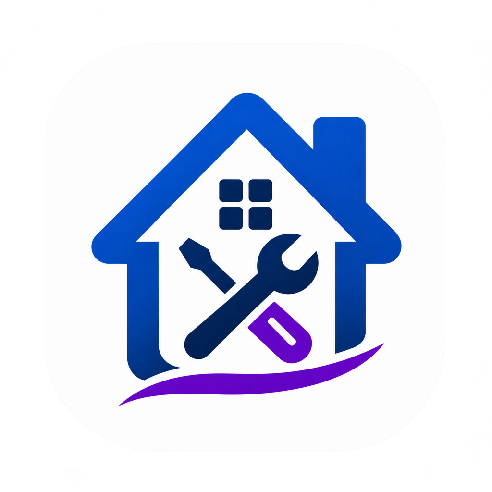
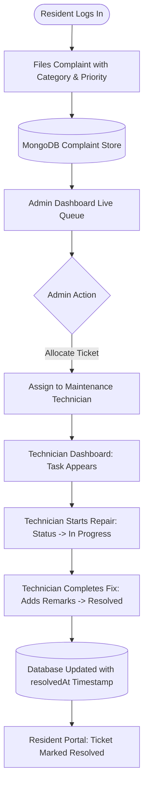
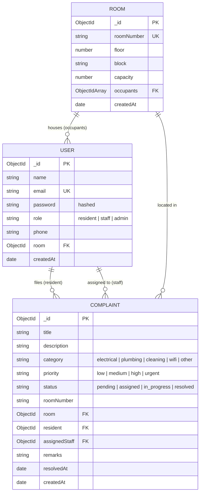

# FixMate – PG & Hostel Maintenance Tracker

<p align="center">
  
</p>

<p align="center">
  <strong>Maintenance Made Simple.</strong>
</p>

<p align="center">
  A production-ready, full-stack MERN platform designed to modernize PG and hostel operations. Streamline ticket reporting, automate technician work orders, and provide real-time resolution transparency for residents, staff, and administrators.
</p>

<p align="center">
  <a href="https://github.com/r0kumar/FixMate/stargazers"></a>
  <a href="https://github.com/r0kumar/FixMate/network/members"></a>
  <a href="https://github.com/r0kumar/FixMate/blob/main/LICENSE"></a>
  <a href="https://react.dev/"></a>
  <a href="https://nodejs.org/"></a>
  <a href="https://expressjs.com/"></a>
  <a href="https://www.mongodb.com/"></a>
  <a href="https://tailwindcss.com/"></a>
  <a href="https://vitejs.dev/"></a>
</p>

---

## 📑 Table of Contents

- [Overview](#-overview)
- [Key Features by Role](#-key-features-by-role)
- [Screenshots & UI Showcase](#-screenshots--ui-showcase)
- [Technology Stack](#-technology-stack)
- [Application Workflow](#-application-workflow)
- [Project Architecture](#-project-architecture)
- [Database Design](#-database-design)
- [Installation & Setup](#-installation--setup)
- [Environment Variables](#-environment-variables)
- [API Documentation](#-api-documentation)
- [Security Implementation](#-security-implementation)
- [Future Roadmap](#-future-roadmap)
- [Engineering Highlights](#-engineering-highlights)
- [Contributing](#-contributing)
- [License](#-license)

---

## 🌐 Overview

In traditional student hostels and Paying Guest (PG) accommodations, maintenance tracking is plagued by:
- **Disorganized physical registers** where tickets are frequently lost or overlooked.
- **Unclear ownership and accountability** among maintenance technicians and wardens.
- **Zero status visibility for residents**, causing repetitive follow-ups and prolonged outages.

### The FixMate Solution
**FixMate** replaces broken manual workflows with a single unified, role-governed digital command center:
- **Residents** lodge detailed complaints in seconds, tag room numbers, set priorities, and track ticket lifecycle changes in real time.
- **Maintenance Staff (Technicians)** receive clear task queues, review room-specific problem descriptions, and update work orders directly from the field.
- **Administrators** retain 360° visibility: allocating work to technicians, overseeing room capacities, inspecting hostel analytics, and resolving backlogs.

---

## ⚡ Key Features by Role

### 🏠 1. Resident Portal
- **One-Click Ticket Filing:** Report issues across standard hostel categories (*Electrical, Plumbing, Cleaning, Wi-Fi, Other*) with priority tagging (*Low, Medium, High, Urgent*).
- **Live Ticket Tracker:** Real-time progression state (`Pending` ➔ `Assigned` ➔ `In Progress` ➔ `Resolved`).
- **Personal Complaint History:** View all past and current maintenance logs with technician remarks and timestamps.
- **Contextual Room Dashboard:** Displays allocated room number, bed status, and direct 24/7 Warden emergency assistance contacts.
- **Interactive Live Search:** Instant keyword lookup with `⌘K` keyboard shortcut support across personal tickets.

### 🔧 2. Maintenance Staff (Technician Hub)
- **Assigned Work Queue:** View tickets specifically allocated to the logged-in technician by the administration.
- **Direct Status Transition:** Transition tickets from `Assigned` to `In Progress`, and mark as `Resolved`.
- **Completion Remarks:** Add actionable handover notes and repair remarks upon task completion.
- **Workforce Summary Widget:** Real-time visibility into open work orders, active shifts, and pending workloads.

### 👑 3. Administrator (Master Control)
- **Operations Metric Dashboard:** High-level overview of total complaints, pending tickets, technician active workloads, and hostel room counts.
- **Ticket Allocation Engine:** Assign or re-allocate tickets to active technicians via an interactive dropdown.
- **Room & Capacity Management:** Add hostel blocks, floors, and room numbers; monitor room occupancies and bed allocation.
- **Staff Onboarding:** Register and provision authenticated staff member accounts.
- **Role-Based Complaint Deletion:** Clean up duplicate or invalid complaint logs.

### 🌍 4. Public Web Pages
- **Modern Responsive Landing Page:** Hero showcase, features breakdown, and workflow overview.
- **Informative Pages:** About Us, Features, Contact Support, Privacy Policy, and Terms & Conditions.
- **Quick Demo Switcher:** 1-click credential auto-fill on `/login` to test **Admin**, **Staff**, and **Resident** portals instantly.

---

## 📸 Screenshots & UI Showcase

> *Tip: To preview the interface, start the app and visit `http://localhost:5173`.*

| Public Experience | Resident Workspace |
| :---: | :---: |
| <br />*Landing Page & Quick Role Switcher* | <br />*Resident Dashboard & Ticket Queue* |

| Technician Work Orders | Admin Master Control |
| :---: | :---: |
| <br />*Active Task Assignment & Remarks* | <br />*Hostel Facilities & Room Management* |

---

## 🛠️ Technology Stack

| Layer | Technologies | Purpose |
| :--- | :--- | :--- |
| **Frontend UI** | React.js 18.3, Vite 6.1 | Fast Single-Page Application (SPA) with HMR |
| **Styling** | Tailwind CSS 3.4, PostCSS, Autoprefixer | Responsive utility styling, custom keyframe animations |
| **Routing** | React Router DOM v6 | Role-based protected routes, declarative navigation |
| **Icons** | Lucide React | Modern, consistent SVG icon set |
| **HTTP Client** | Axios 1.7 | Centralized API client with JWT Bearer request interceptors |
| **Backend Runtime** | Node.js (v20+), Express.js 4.21 | RESTful API server with modular route-controller structure |
| **Database** | MongoDB, Mongoose 8.23 | NoSQL object modeling, population, and validation hooks |
| **Security** | JWT (`jsonwebtoken`), `bcryptjs` | Stateless session tokens, 10-round salted password hashing |
| **CORS & Env** | `cors`, `dotenv` | Cross-Origin Resource Sharing & runtime configuration |
| **Deployment** | Vercel (Frontend), Render (Backend) | Single-click cloud deployment with SPA rewrites |

---

## 🔄 Application Workflow



---

## 📂 Project Architecture

```
FixMate/
├── Frontend/                      # React 18 + Vite client application
│   ├── public/                    # Static browser assets
│   │   ├── favicon.ico            # Multi-size favicons & webmanifest
│   │   ├── site.webmanifest       # PWA metadata
│   │   └── _redirects             # Netlify SPA redirect rules
│   ├── src/
│   │   ├── assets/                # Optimized branding icons & logos
│   │   │   ├── icon.png           # FixMate repair badge
│   │   │   └── logo.png           # Official brand logo
│   │   ├── components/            # Reusable UI components
│   │   │   ├── ComplaintCard.jsx  # Card presentation for tickets
│   │   │   ├── DashboardFooter.jsx# Compact dashboard footer
│   │   │   ├── Navbar.jsx         # Live search bar, user menu & alerts
│   │   │   ├── PublicFooter.jsx   # Rich 4-column footer for public pages
│   │   │   └── Sidebar.jsx        # Role-governed multi-section navigation
│   │   ├── context/
│   │   │   └── AuthContext.jsx    # Global JWT auth state & auto-redirects
│   │   ├── pages/                 # Route views
│   │   │   ├── Home.jsx           # Landing page
│   │   │   ├── About.jsx          # Mission & team info
│   │   │   ├── Features.jsx       # Detailed capabilities breakdown
│   │   │   ├── Contact.jsx        # Warden & facilities desk contact
│   │   │   ├── Privacy.jsx        # Data privacy terms
│   │   │   ├── Terms.jsx          # Terms of service
│   │   │   ├── Login.jsx          # Auth screen with 1-click role switcher
│   │   │   ├── Register.jsx       # Resident onboarding form
│   │   │   ├── admin/             # Admin portal (Dashboard, Complaints, Rooms, Staff)
│   │   │   ├── resident/          # Resident portal (Dashboard, NewComplaint, MyComplaints)
│   │   │   └── staff/             # Staff portal (Dashboard, MyTasks)
│   │   ├── services/
│   │   │   └── api.js             # Axios instance with auth interceptor
│   │   ├── App.jsx                # Route registry & ProtectedRoute wrapper
│   │   ├── index.css              # Tailwind base, components & keyframes
│   │   └── main.jsx               # Application DOM entry point
│   ├── .env.example               # Frontend environment template
│   ├── vercel.json                # Vercel SPA routing rewrite rules
│   ├── vite.config.js             # Vite proxy and build configuration
│   └── package.json
│
├── Backend/                       # Express.js REST API
│   ├── src/
│   │   ├── config/
│   │   │   └── db.js              # Mongoose MongoDB connection
│   │   ├── controllers/           # HTTP request handlers
│   │   │   ├── authController.js  # Registration, login, profile, staff creation
│   │   │   ├── complaintController.js # Ticket CRUD, filters, assignment, stats
│   │   │   ├── roomController.js  # Hostel room & occupant management
│   │   │   └── userController.js  # User queries & profile updates
│   │   ├── middleware/
│   │   │   ├── auth.js            # JWT verification & req.user injection
│   │   │   └── role.js            # Role authorization guard (authorize(...roles))
│   │   ├── models/                # Mongoose data schemas
│   │   │   ├── Complaint.js       # Ticket model with enums & timestamps
│   │   │   ├── Room.js            # Hostel rooms, blocks & occupant links
│   │   │   └── User.js            # User accounts, bcrypt hashing & roles
│   │   ├── routes/                # Express router endpoints
│   │   │   ├── authRoutes.js      # /api/auth/*
│   │   │   ├── complaintRoutes.js # /api/complaints/*
│   │   │   ├── roomRoutes.js      # /api/rooms/*
│   │   │   └── userRoutes.js      # /api/users/*
│   │   ├── app.js                 # Express middleware configuration
│   │   ├── server.js              # Server bootstrapper & listener
│   │   ├── seed.js                # Database seeder with sample accounts
│   │   └── viewDb.js              # CLI tool for inspecting collections
│   ├── .env.example               # Backend environment template
│   └── package.json
│
├── .gitignore
└── README.md
```

---

## 🗄️ Database Design



---

## 🚀 Installation & Setup

### Prerequisites
- **Node.js**: v18.0.0 or higher
- **npm**: v9.0.0 or higher
- **MongoDB**: Local MongoDB instance (`mongodb://127.0.0.1:27017`) or a free [MongoDB Atlas](https://www.mongodb.com/cloud/atlas) cloud cluster.

---

### Step 1: Clone the Repository
```bash
git clone https://github.com/r0kumar/FixMate.git
cd FixMate
```

---

### Step 2: Configure & Start the Backend

1. Navigate to the `Backend` directory:
   ```bash
   cd Backend
   ```
2. Install dependencies:
   ```bash
   npm install
   ```
3. Create your environment file:
   ```bash
   cp .env.example .env
   ```
   *(Update `MONGO_URI` and `JWT_SECRET` in `.env` as required).*

4. **(Optional)** Seed demo users and sample maintenance tickets:
   ```bash
   npm run seed
   ```

5. Start the backend development server:
   ```bash
   npm run dev
   ```
   *The API will be running on `http://localhost:5000`.*

---

### Step 3: Configure & Start the Frontend

1. Open a new terminal and navigate to `Frontend`:
   ```bash
   cd Frontend
   ```
2. Install dependencies:
   ```bash
   npm install
   ```
3. Create your local environment configuration:
   ```bash
   cp .env.example .env
   ```
4. Start the frontend Vite development server:
   ```bash
   npm run dev
   ```
   *Open [http://localhost:5173](http://localhost:5173) in your browser.*

---

### 🔑 Demo Accounts (Created by `npm run seed`)

| Role | Email | Password | Access Rights |
| :--- | :--- | :--- | :--- |
| **Admin** | `admin@fixmate.com` | `password123` | Full control: room management, staff creation, ticket assignment |
| **Staff** | `staff@fixmate.com` | `password123` | Assigned work orders, status updates, completion remarks |
| **Resident** | `resident@fixmate.com` | `password123` | Issue submission, personal tracking, warden assistance |

---

## 🔐 Environment Variables

### Backend (`Backend/.env`)
```env
# Server Port
PORT=5000

# MongoDB Connection String (Local or Atlas)
MONGO_URI=mongodb://127.0.0.1:27017/fixmate

# JWT Signing Secret (Generate a strong random string for production)
JWT_SECRET=your_jwt_secret_key_here

# Frontend Application URL (Used for CORS validation)
CLIENT_URL=http://localhost:5173
```

### Frontend (`Frontend/.env`)
```env
# Backend API Base URL
VITE_API_URL=http://localhost:5000/api
```

---

## 📡 API Documentation

All routes (except `/api/auth/register` and `/api/auth/login`) require a valid JWT token passed in the `Authorization: Bearer <token>` header.

### Authentication (`/api/auth`)
| Method | Endpoint | Description | Access |
| :--- | :--- | :--- | :--- |
| `POST` | `/api/auth/register` | Register a new resident account | Public |
| `POST` | `/api/auth/login` | Authenticate user & return JWT token | Public |
| `GET` | `/api/auth/me` | Fetch authenticated user profile & room | Private |
| `POST` | `/api/auth/create-staff` | Provision a new staff/technician account | Admin only |

### Complaints (`/api/complaints`)
| Method | Endpoint | Description | Access |
| :--- | :--- | :--- | :--- |
| `GET` | `/api/complaints` | Fetch complaints (scoped by role; supports `?search=`, `?category=`, `?status=`) | Private |
| `POST` | `/api/complaints` | Submit a new maintenance ticket | Resident, Admin |
| `GET` | `/api/complaints/staff` | Fetch list of active maintenance technicians | Admin only |
| `GET` | `/api/complaints/:id` | Get full details of a specific complaint | Ticket Owner, Assigned Staff, Admin |
| `PATCH` | `/api/complaints/:id/assign` | Assign ticket to a maintenance technician | Admin only |
| `PATCH` | `/api/complaints/:id/status` | Update ticket progress status & append remarks | Admin, Staff |
| `DELETE` | `/api/complaints/:id` | Delete a complaint record | Admin only |

### Rooms (`/api/rooms`)
| Method | Endpoint | Description | Access |
| :--- | :--- | :--- | :--- |
| `GET` | `/api/rooms` | Retrieve all rooms with occupants | Private |
| `POST` | `/api/rooms` | Create a new room (*roomNumber, floor, block, capacity*) | Admin only |
| `PATCH` | `/api/rooms/:id` | Modify room metadata or occupants | Admin only |
| `DELETE` | `/api/rooms/:id` | Delete a room record | Admin only |

### Users (`/api/users`)
| Method | Endpoint | Description | Access |
| :--- | :--- | :--- | :--- |
| `GET` | `/api/users` | List users (optional `?role=resident\|staff\|admin`) | Private |
| `GET` | `/api/users/:id` | Get user by ID | Private |
| `PATCH` | `/api/users/:id` | Update profile details | Account Owner, Admin |
| `DELETE` | `/api/users/:id` | Delete a user account | Admin only |

---

## 🔒 Security Implementation

- **Bcrypt Password Hashing:** User passwords are automatically salted and hashed via Mongoose pre-save middleware (`bcrypt.genSalt(10)`). Passwords are never stored in plain text and are excluded by default in queries (`select: false`).
- **Stateless JWT Authorization:** Access tokens are cryptographically signed with a private secret and verified on protected endpoints through `protect` middleware.
- **Role-Based Access Control (RBAC):** Custom `authorize(...roles)` middleware strictly guards sensitive endpoints (e.g., room creation, staff provisioning, technician reassignment).
- **Data Scoping:** Database queries automatically restrict data visibility:
  - Residents can only retrieve their own filed complaints.
  - Technicians can only access complaints assigned to their ID.
  - Admins can query all hostel tickets.
- **Sanitized Inputs:** Strict Mongoose schemas with regex validators, trim options, and enum constraints prevent invalid data entries.
- **Frontend Interceptors:** Centralized Axios instance automatically injects the `Bearer` token and purges expired sessions on `401 Unauthorized`.

---

## 🔮 Future Roadmap

- [ ] **Real-Time Push Notifications:** Instant browser & mobile alerts when a ticket status changes using WebSockets / Socket.io.
- [ ] **Photo Uploads via Cloud Storage:** Direct camera capture and attachment of damaged fixtures via Cloudinary or AWS S3.
- [ ] **SMS / WhatsApp Alerts:** Automated Warden alerts for `Urgent` severity tickets (e.g., water leakages, short circuits).
- [ ] **SLA & Escalation Engine:** Automatically flag tickets unresolved after 24/48 hours and notify the head warden.
- [ ] **Hostel Fee & Room Rent Tracker:** Digital rent and maintenance ledger integrated with Razorpay / Stripe.

---

## 💡 Engineering Highlights

FixMate demonstrates key full-stack software engineering principles:
1. **Decoupled Architecture:** Clean separation of concerns between client UI logic, REST controllers, and database models.
2. **Robust Multi-Role Routing:** Role-aware `ProtectedRoute` components prevent unauthorized client access and ensure smooth redirects.
3. **Optimized Build Configuration:** Fast Vite compilation, Tailwind CSS purging, and lightweight bundle footprint (~108 KB gzipped JS).
4. **Resilient Data Layer:** Mongoose population handles complex document relations (`User ↔ Room ↔ Complaint`) with referential integrity.

---

## 🤝 Contributing

Contributions are welcome! If you'd like to improve FixMate:

1. **Fork the Repository**
2. **Create a Feature Branch:**
   ```bash
   git checkout -b feature/YourFeatureName
   ```
3. **Commit Your Changes:**
   ```bash
   git commit -m "Add: YourFeatureName description"
   ```
4. **Push to the Branch:**
   ```bash
   git push origin feature/YourFeatureName
   ```
5. **Open a Pull Request**

---

## 📄 License

This project is licensed under the **MIT License** — feel free to use, modify, and distribute this codebase for learning or production purposes.

---

<p align="center">
  <strong>FixMate</strong> • Built with ❤️ for smarter hostel living.
</p>
