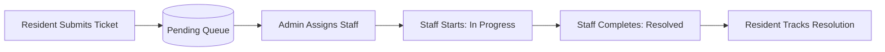

<div align="center">


# FixMate

**Maintenance Made Simple.**

A modern full-stack MERN platform designed to streamline complaint management, technician work orders, and resolution tracking for PG and hostel accommodations.

[](https://react.dev/)
[](https://nodejs.org/)
[](https://expressjs.com/)
[](https://www.mongodb.com/)
[](https://tailwindcss.com/)
[](https://vitejs.dev/)
[](https://opensource.org/licenses/MIT)

</div>

---

## 🌐 Live Demo

> **Status:** 🟡 **Coming Soon – Deployment in Progress**  
> **Live URL:** `https://your-deployment-url-here.com` *(Placeholder — will be updated upon production release)*

---

## 📖 About

FixMate replaces manual paper registers and chaotic messaging with a centralized, role-based maintenance portal. It connects hostel residents, maintenance staff, and administrators in a single transparent workflow—ensuring issues are reported instantly, assigned without delay, and resolved with full accountability.

---

## ✨ Key Features

### 🏠 Resident
- **Submit Complaints:** File tickets across categories (*Electrical, Plumbing, Cleaning, Wi-Fi, Other*) with priority levels (*Low, Medium, High, Urgent*).
- **Track Status:** Monitor complaint progress in real time (`Pending` ➔ `Assigned` ➔ `In Progress` ➔ `Resolved`).
- **History & Room Desk:** Review personal ticket history, resolution remarks, and access 24/7 warden emergency contacts.

### 👑 Administrator
- **Operations Dashboard:** High-level overview of total complaints, pending tickets, technician active workloads, and hostel rooms.
- **Task Assignment:** Assign tickets to specific maintenance technicians via interactive dropdowns.
- **Room Management:** Add and manage hostel rooms, blocks, floor numbers, and occupant capacity.
- **Staff Onboarding:** Register and provision authenticated maintenance staff accounts.

### 🔧 Maintenance Staff (Technician)
- **Work Order Queue:** View maintenance jobs specifically assigned to the logged-in technician.
- **Status Updates:** Update ticket progress to `In Progress` and mark as `Resolved`.
- **Completion Remarks:** Add repair notes and handover remarks upon completing a job.

---

## 🛠️ Tech Stack

| Category | Technologies |
| :--- | :--- |
| **Frontend** | React 18, Vite 6, React Router DOM v6, Axios, Lucide React |
| **Backend** | Node.js, Express.js (REST API Architecture) |
| **Database** | MongoDB, Mongoose 8 (Schema validation & population) |
| **Authentication** | JWT (`jsonwebtoken`), `bcryptjs` (Salted password hashing) |
| **Styling** | Tailwind CSS 3.4, PostCSS, Autoprefixer |

---

## 🔄 Complaint Workflow



---

## 📸 Screenshots

### 1. Public & Authentication

| Home Landing Page | Sign In & Demo Role Switcher |
| :---: | :---: |
|  |  |
| *Hero showcase & feature overview* | *Secure login with 1-click demo credentials switcher* |

### 2. Role-Based Dashboards

| Resident Portal | Maintenance Staff Hub |
| :---: | :---: |
|  |  |
| *Ticket submission, room desk & live status tracking* | *Assigned work orders, status toggles & remarks* |

| Admin Master Control |
| :---: |
|  |
| *Hostel operations overview, ticket allocation & room management* |

---

## 🚀 Installation & Setup

### 1. Clone the Repository
```bash
git clone https://github.com/r0kumar/FixMate-PG-Hostel-Maintenance-Tracker.git
cd FixMate-PG-Hostel-Maintenance-Tracker
```

### 2. Backend Setup
```bash
cd Backend
npm install
cp .env.example .env     # Set MONGO_URI and JWT_SECRET as needed
npm run seed             # (Optional) Pre-loads demo accounts & sample tickets
npm run dev
```
*Backend runs on `http://localhost:5000`*

### 3. Frontend Setup
```bash
cd ../Frontend
npm install
cp .env.example .env     # Set VITE_API_URL=http://localhost:5000/api
npm run dev
```
*Frontend runs on `http://localhost:5173`*

### 🔑 Demo Accounts (from `npm run seed`)
| Role | Email | Password |
| :--- | :--- | :--- |
| **Admin** | `admin@fixmate.com` | `password123` |
| **Staff** | `staff@fixmate.com` | `password123` |
| **Resident** | `resident@fixmate.com` | `password123` |

---

## 🔮 Future Improvements

1. **Real-Time Alerts:** Live push and WebSocket (Socket.io) notifications on ticket status updates.
2. **Photo Attachments:** Camera capture and damage photo uploads via Cloudinary / AWS S3.
3. **Automated SLA Escalation:** Auto-flag and escalate tickets unresolved after 24/48 hours.
4. **WhatsApp & SMS Alerts:** Instant messaging notifications for urgent room repairs.

---

<div align="center">
  <sub>Built with ❤️ by <a href="https://github.com/r0kumar">r0kumar</a> • Licensed under the MIT License</sub>
</div>
